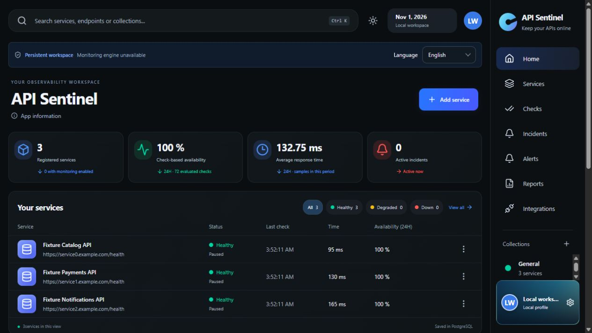
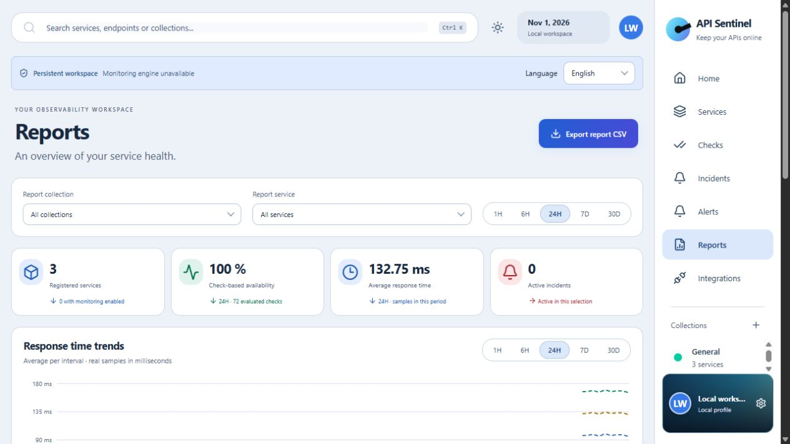

# API Sentinel

A local HTTP service monitor with a React dashboard, a FastAPI scheduler and PostgreSQL history. Prepared as a candidate for Alignerr LBLX135; acceptance has not been granted or verified.

## Implemented

- Service and collection management; scheduled and manual **GET/HEAD** checks.
- Expected status ranges, latency thresholds, pause/resume, bounded concurrency and retries.
- Incidents and recovery tracking, in-app alerts, read/unread history.
- Sample-based availability, latency percentiles, period charts, activity map and CSV export.
- English/Spanish, light/dark themes and browser-local profile/avatar framing.
- Database migrations, a test suite and a verified GitHub Actions workflow.

Scheduled checks continue only while the backend is running. Profile, images, language and theme are stored in the browser; monitoring history is in PostgreSQL. CSV exports neutralize spreadsheet formulas in text fields. Availability measures observed checks, not continuous uptime or a contractual SLA.

## Preview

These are **fictional, inserted fixtures**, not measured results from a customer's or the author's servers. All fixture services are paused and the monitoring engine is disabled. No profile photo or operational data from the existing installation was copied.




## Stack

Python 3.12, FastAPI, SQLAlchemy 2, Alembic, Psycopg 3, PostgreSQL 18; Node.js 22.12+ (22.x recommended), React 19, TypeScript, Vite, TanStack Query, Recharts and Lucide icons. Lockfiles are included.

## Install and run

Use a **fresh checkout**. Do not copy an existing .env, .runtime, PostgreSQL directory or browser profile. See [Linux/WSL2](docs/WSL2.md) for reproducible native and Docker instructions and [Windows](docs/WINDOWS.md) for a separate local installation.

Candidate defaults are UI **5175**, API **8002**, PostgreSQL **55434**, database **api_sentinel_review**. Earlier copies used 55432 or 55433: those ports and databases are not migrated or reused. All network listeners must remain on loopback. Docker publishes only PostgreSQL, also on loopback.

Native Linux quick start after installing the prerequisites:

```bash
python3.12 -m venv .venv
source .venv/bin/activate
python -m pip install -r backend/requirements.lock.txt
npm ci --ignore-scripts
python scripts/init-linux-db.py init
python -m alembic -c backend/alembic.ini upgrade head
bash scripts/start-linux.sh
# In another terminal in this checkout:
npm run dev
```

Open http://127.0.0.1:5175/ and API contracts at http://127.0.0.1:8002/docs. The generated ignored .env disables monitoring by default. To monitor an authorized endpoint, set SENTINEL_MONITORING_ENABLED=true locally, restart the API, and add a GET/HEAD health endpoint with explicit authorization. Do not activate fictional fixture URLs. Stop API/UI with Ctrl+C; stop the native Linux cluster with `python scripts/init-linux-db.py stop`. Data is retained.

## Tests

Use a disposable database. The suite requires an explicit test URL and creates/drops a random schema; it never falls back to the configured runtime database. Set the test URL without printing the password:

```bash
source .venv/bin/activate
export SENTINEL_MONITORING_ENABLED=false
export SENTINEL_TEST_DATABASE_URL="$(python -c 'import sys; sys.path.insert(0,"backend"); from sentinel.config import get_settings; print(get_settings().connection_url().render_as_string(hide_password=False))')"
python -m alembic -c backend/alembic.ini upgrade head
python -m pytest -q backend/tests
python -m ruff check backend scripts
python -m alembic -c backend/alembic.ini check
npm test
npm run build
npm audit
unset SENTINEL_TEST_DATABASE_URL
```

106 backend tests and 24 frontend tests passed locally on Windows with an isolated PostgreSQL 18 cluster. The [first real GitHub Actions run](https://github.com/wasatnight/api-sentinel/actions/runs/41297019150) also passed on Ubuntu 24.04 with Python 3.12, Node 22 and PostgreSQL 18, including migrations, tests, Ruff, schema verification, build and npm audit. Native WSL2 installation/startup remains unverified on this computer. See [validation](docs/VALIDATION.md).

## Security and scope

Only public HTTP/HTTPS destinations you own or are authorized to monitor. GET/HEAD can still have side effects on poorly designed servers: authorization is required. No custom request bodies, cookies or authentication headers. URL credential/secret-query checks, public-address validation at connection time, redirect validation, TLS verification, time/size limits and safe retries reduce risk. The code uses a version-pinned private HTTPCore adapter which requires regression tests when upgrading.

This is a monitoring application; no exploit payload generator, credential attack, vulnerability scanner or exploitation framework was identified in the reviewed source. Its local API uses POST/PUT/DELETE to manage its own records; outbound probes are GET/HEAD only. Security controls do not make it suitable for public hosting.

See [SECURITY.md](SECURITY.md), [third-party notices](THIRD_PARTY_NOTICES.md) and [provenance](docs/PROVENANCE.md).

## Limitations and useful next work

- Local single workspace; **no authentication, user accounts or multiuser authorization**. CORS/host checks are not authentication.
- **No email/webhooks, external notification delivery or production integrations.** Integrations is a descriptive placeholder.
- **No automatic retention**, log rotation, hosted deployment or installer.
- Browser preferences are not part of a PostgreSQL backup.
- Windows DPAPI scripts are Windows-only. Linux uses local environment configuration, never DPAPI.
- WSL2/native Linux startup still needs validation. Automated Linux checks have passed in GitHub Actions.
- Possible development tasks: retention policies with tests, authenticated workspace boundaries, opt-in notification adapters, reproducible Linux smoke tests and better accessibility/end-to-end coverage. These are proposals, not implemented features.

## Project status and license

The owner confirmed this is a personal initiative and authorized sharing code excluding private configuration and personal servers. Development was assisted by OpenAI Codex. This does not establish exclusive authorship of dependencies, icons or referenced artwork.

Project code is available under the [MIT License](LICENSE), copyright (c) 2026 wasatnight. The owner explicitly approved this license and public GitHub publication on 2026-11-01. Third-party packages retain their respective licenses. Alignerr eligibility and approval remain pending; see the [submission draft](docs/ALIGNERR.md).
